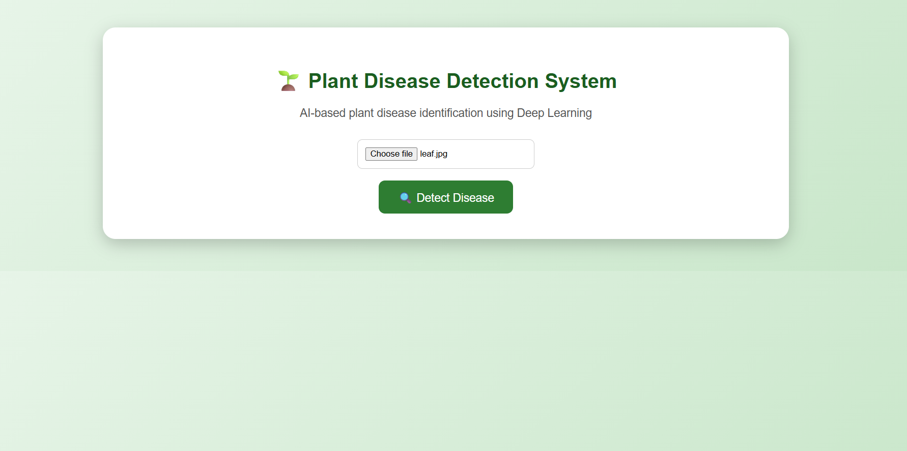
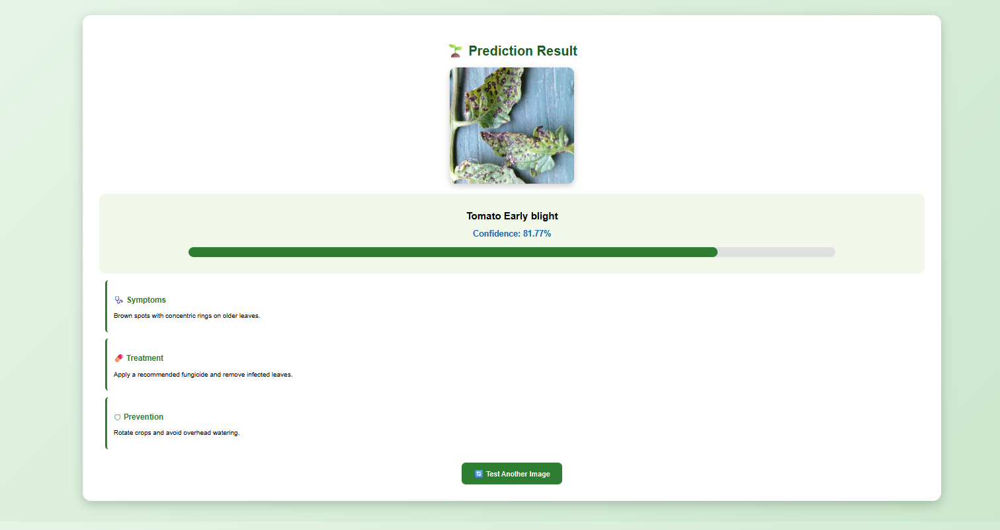

# 🌱 Plant Disease Detection System

## Overview

Plant Disease Detection System is an AI-powered web application that identifies plant diseases from leaf images using Deep Learning.

The system uses a Convolutional Neural Network (CNN) model trained on the PlantVillage dataset and provides disease prediction along with confidence, symptoms, treatment, and prevention information.

---

## Features

- Upload plant leaf images
- AI-based disease detection
- Confidence score display
- Confidence visualization bar
- Disease symptoms information
- Treatment recommendations
- Prevention methods
- User-friendly web interface

---

## Technologies Used

### Programming Language
- Python

### Backend
- Flask

### Deep Learning
- TensorFlow
- Keras
- CNN Model

### Frontend
- HTML
- CSS
- JavaScript

### Dataset
- PlantVillage Dataset

---

## Project Structure
PlantDiseaseDetection
│
├── app.py
├── plant_disease_final.keras
├── requirements.txt
├── README.md
│
├── static
│ ├── style.css
│ └── uploads
│
└── templates
├── index.html
└── result.html

## Installation

### Step 1: Clone the repository
git clone <your-github-link>

### Step 2: Create virtual environment
python -m venv venv

### Step 3: Activate virtual environment
Windows:
venv\Scripts\activate

### Step 4: Install dependencies
pip install -r requirements.txt

### Step 5: Run the application
python app.py
Open in browser:
http://127.0.0.1:5000/

## How It Works

1. User uploads a plant leaf image.
2. Flask receives the image through the web interface.
3. The image is resized to 224×224 pixels.
4. The CNN model analyzes the image.
5. The predicted disease and confidence score are generated.
6. Disease information, treatment, and prevention are displayed.

## Screenshots

### Home Page

### Result Page

